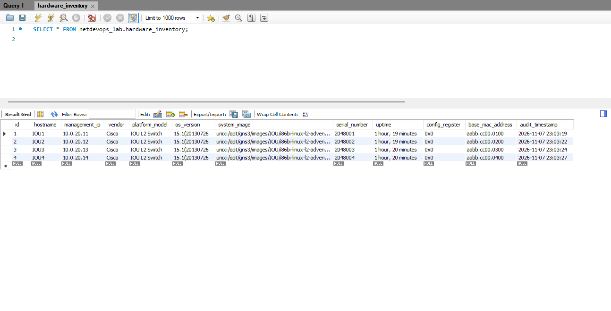

# CCNA Network Infrastructure & Automation Lab

## Overview
This repository contains the baseline configurations and automation scripts for a 5-node CCNA enterprise topology built in GNS3. The project demonstrates Layer 2 switching resiliency, Inter-VLAN routing, and network programmability.

## Topology Architecture
*   **R1 (Cisco 7200):** Router-on-a-stick providing Inter-VLAN routing.
*   **IOU1 (Core Switch):** Primary Root Bridge for all VLANs.
*   **IOU2 (Access):** Edge connectivity mapping to PC1 (VLAN 10).
*   **IOU3 & IOU4 (Access):** Redundant physical triangle topology demonstrating Rapid PVST+ loop prevention and instant failover capabilities. 

## Technologies & Protocols
*   **Environment:** GNS3, Cisco IOU (Layer 2), VirtualBox (Host networking)
*   **Layer 2:** Rapid PVST+ (802.1w), 802.1Q Trunking, DTP negotiation mitigation
*   **Security:** PortFast, BPDU Guard
*   **Automation:** Python 3, Netmiko (In progress)

## Prerequisites
*   [GNS3](https://www.gns3.com/) installed with Cisco IOU support.
*   Python 3.8+ for automation scripts.
*   Required Python modules:
    ```bash
    pip install netmiko
    ```

## Repository Structure
*   `configs/` - Raw baseline startup configurations (NVRAM state) for all nodes.
*   `scripts/` - Python automation scripts for data collection and provisioning. *(Upcoming)*

## Python Automation & Database Integration
Using **Netmiko**, I engineered a Python pipeline to automatically SSH into the GNS3 management network, bypass legacy crypto blocks, and extract live hardware telemetry (`show version`, `show interfaces`). 

The raw text data is parsed using **Regex** and injected directly into a local **MySQL** relational database to maintain an automated, field-engineer-style hardware inventory.

